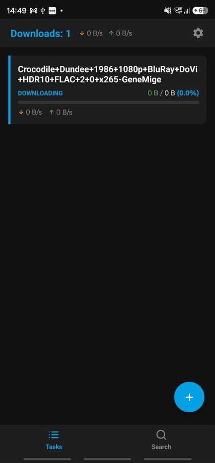

# Better DS Get

A fast, lightweight, pure native Android client (Java) for Synology's Download Station, featuring **QuickConnect + QuickConnect Relay** support, **BT Search**, **live download speedometer notifications**, and direct `.torrent` / `magnet:` intent handling — in a **~608 KB** zero-dependency APK.



[View Changelog](./CHANGELOG.md)

## Repository Structure

- **[`native-android/`](./native-android)** — Active **v1.6.0+** pure Android Java codebase (zero third-party runtime dependencies; uses only the Android SDK and `org.json`).
- **Root React Native / Expo files** (`App.tsx`, `src/`, `plugins/`, `package.json`, `app.json`) — Legacy **v1.0.0–v1.5.1** implementation, retained temporarily for reference during the transition. Once retired, `native-android/` will be promoted to the repository root.

## Why "Better"?

Original Synology "DS Get" app suffered from several issues:
- **Connectivity**: Frequent logouts and session timeouts.
- **Search**: For search prompts that were too broad, the app would just log you out, breaking the search flow.

## Features

- **Connect to your Synology NAS**: Supports HTTP/HTTPS (including self-signed LAN certificates), **QuickConnect IDs** with **QuickConnect Relay** fallback (works even without router port forwarding), and automatic roaming re-resolution when switching between Wi-Fi and cellular.
- **Integrated BT Search**: Search directly from the app using the enabled search engines configured on your NAS. Per-engine progress is shown in an **expandable status panel**, and results are **sortable by Seeds or Size** (toggleable direction).
- **Manage Download Tasks**: View, pause, resume, and remove tasks with real-time 3-second polling, Material pull-to-refresh, colored speed indicators, and live status updates during session restore.
- **Add New Tasks**:
  - One-tap addition from search results.
  - Submit `magnet:` links / URLs — intercepts links directly from browsers.
  - Open or upload `.torrent` files via direct in-memory multipart streaming.
  - **Dynamic Destination Selection**: Choose download folders (with `(Default)` indicator) and 1-tap **Recent Folders**.
  - **Selective Download**: Choose individual files *before* adding a torrent to the queue (virtualized list supporting 4,000+ files).
- **View Task Details**: Merged **Info** tab with ETA, smart piece counts, destination, and creation/completion timestamps; **Tracker** tab with geolocation flags, protocol badges (`UDP`/`HTTPS`/`HTTP`), and working-first sorting; **Peers** tab with country flags; and **File** tab with per-file priority toggles.
- **Technical Transparency**: Use the "Connection Info" overlay to see resolved URLs, protocol security, API counts, and session status.
- **Smart Persistence & Stability**: Remembers URL/QuickConnect ID, account, and password; keeps sessions alive with a periodic heartbeat; supports on-demand 2FA/OTP login while preserving entered credentials.
- **Smart Foreground Notification Service**: Live 3-second speedometer in the notification bar for active downloads plus tap-to-open completion/error notifications.

## Getting Started (Native Android `v1.6.0+`)

### Prerequisites
- JDK 17
- Android SDK (`compileSdk 36`, `targetSdk 35`, `minSdk 26`)

### Build & Test

1. Clone the repository:
   ```bash
   git clone https://github.com/antimirov/better_ds_get.git
   cd better_ds_get/native-android
   ```

2. Run the automated JUnit & `MockWebServer` test suite:
   ```bash
   ./gradlew test
   ```

3. Build the release APK:
   ```bash
   ./gradlew assembleRelease
   ```
   *(If `native-android/keystore.properties` is present, release builds are signed with your release keystore; otherwise Gradle falls back to the debug keystore for local builds.)*

<details>
<summary>Legacy React Native / Expo Setup (v1.5.1 and earlier)</summary>

```bash
npm install
npx expo start
```

</details>

## Roadmap

- [x] Implement torrent searching using configured engines.
- [x] Support for QuickConnect and HTTPS.
- [x] Individual file priority management.
- [x] **v1.1.0 Release** (Search, QuickConnect, Password Persistence).
- [x] Support for selecting destination directory before adding a new torrent.
- [x] Add progress bar to each download item in the main window.
- [x] Add country flags to peers and trackers based on IP geolocation.
- [x] Implement Android hardware back button support for all modals.
- [x] **v1.2.0 Release** (Trackers, Android UX, Layout Optimization, **Selective Download**, **Real-time Stats**).
- [x] Add Intent Filter for magnet links and .torrent files.
- [x] **v1.3.0 Release** (Intent Filters, Deep Linking, Safe Content Handlers).
- [x] Merge General + Transfer tabs into a single Info tab.
- [x] Add About section to Settings.
- [x] MFA/OTP on-demand login flow.
- [x] Fix search polling race condition.
- [x] Add expandable per-engine search status panel.
- [x] Add sortable search results (Seeds / Size with direction toggle).
- [x] Fix repeated-search degradation (cleanup race condition).
- [x] **v1.4.0 Release** (UX Polish, Search Fixes, Engine Status Panel, Sortable Results, **Smart Foreground Tracking**, Custom Icon).
- [x] **v1.5.0–v1.5.1 Releases** (Torrent Intent Destination Selection, Native Background Timer, DSM Engine Preferences, Concurrent Abort Isolation).
- [x] **v1.6.0 Release** (Pure Native Android Java Rewrite, ~608 KB APK, QuickConnect Relay & Roaming Re-Resolution, Live Restore Progress, Automated Test Suite).
- [ ] Promote `native-android/` to repository root and retire legacy React Native files.
- [ ] Add a "Remember Me" checkbox to the login screen.
- [ ] Dark mode - ability to switch to light theme.

## License

This project is open-source. Please see the LICENSE file for details.
